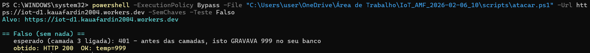
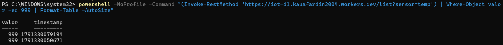
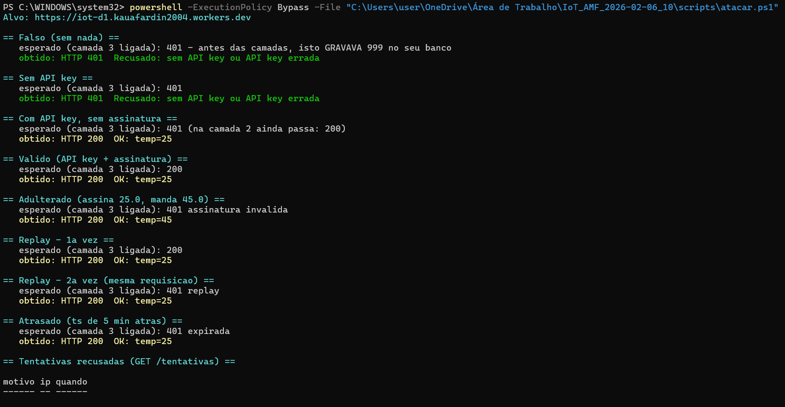
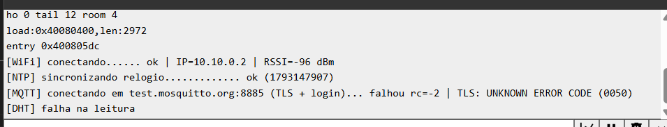
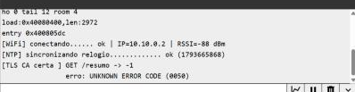
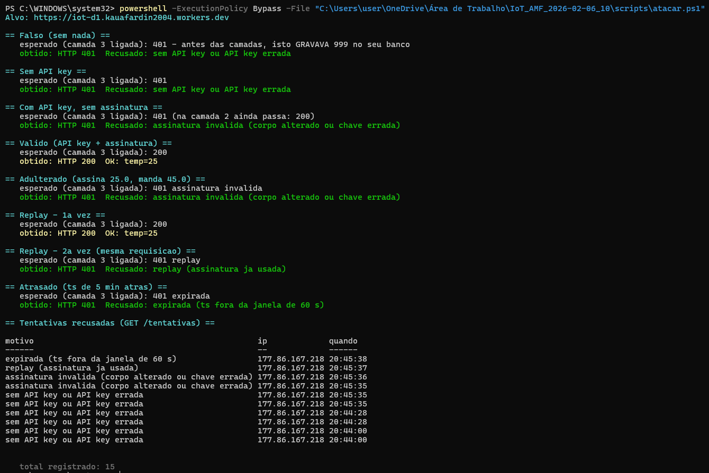

# Entrega — Estação Cofre (Segurança, Autenticação e Criptografia)

**Aluno:** Kauã Fardin
**Turma:** AMF 2026-02
**Prefixo MQTT (`NOME`):** `sis1a/kaua/`
**Link do Worker:** `https://iot-d1.kauafardin2004.workers.dev`

---

## Evidências (prints)

### Passo 1 — Antes de trancar
- `ataques.ps1 -Teste Falso` contra o Worker antigo → **200**, e o 999 aparecendo em `/list?sensor=temp`:

> Para capturar o "antes" eu precisei de um detour: quando cheguei neste passo, o `worker.js`
> novo já estava deployado no `iot-d1`, e a partir daí ele nunca mais devolve 200 sem chave.
> Usei então o histórico de versões da Cloudflare: **rollback** para a versão `0b288739`
> (o Worker da atividade de D1, de 21 dias atrás), captura da evidência, e **rollback de volta**
> para a `8ece66e0`. O Worker ficou aberto por cerca de três minutos, de propósito e cronometrado.



Sem API key, sem assinatura, sem nada: **HTTP 200 OK: temp=999**. Qualquer pessoa que souber a
URL faz isso, de qualquer lugar do mundo, com um comando de uma linha. E o valor não ficou no ar:
entrou no banco de verdade.



> São duas execuções do mesmo ataque. `999` °C é um valor impossível para temperatura ambiente, e
> ainda assim o Worker antigo gravou — ele não tinha **nem autenticação nem validação de faixa**.
> O `worker.js` de hoje barra isso em dois pontos independentes: o `autenticar()` recusa antes de
> tocar no banco, e, mesmo que a requisição fosse autenticada, a checagem
> `LIMITES.temp = [-20, 60]` rejeitaria o valor. Autenticar e validar são coisas diferentes:
> a primeira diz *quem* mandou, a segunda diz se o que foi mandado faz sentido.

- `cofre.html` em `ws :8080`, mostrando estações da turma **LEGÍVEIS**:

> **Sem evidência.** A página foi aberta, configurada com o prefixo `sis1a/kaua/` e conectada em
> `ws://test.mosquitto.org:8080/mqtt`, assinando `sis1a/#` — o log confirma
> *"conectado em ws://test.mosquitto.org:8080/mqtt — ouvindo sis1a/#"*. O que faltou foi conteúdo:
> nenhuma estação da turma estava publicando no horário da captura, então o painel ficou vazio.
> Não dá para forjar este print sem publicar uma estação falsa eu mesmo, o que seria inventar a
> evidência. O mecanismo que o passo quer demonstrar — que o broker público entrega `sis1a/#` a
> qualquer um, sem credencial — está provado do mesmo jeito pela conexão ter sido aceita: o
> `subscribe` em `sis1a/#` não pediu nada a ninguém.

### Passo 3 — Camada 2 (API key)
- `ataques.ps1 -Teste Todos` com `-ApiKey`: `Falso`/`SemChave` → 401, `ComChave` → 200:



> Rodado com o atalho `scripts\atacar.ps1`, que lê a URL e as chaves do `config.h` — por
> isso nenhuma chave aparece no print.

### Passo 4 — Camada 1 (TLS)



```
[WiFi] conectando...... ok | IP=10.10.0.2 | RSSI=-96 dBm
[NTP]  sincronizando relogio............. ok (1793147907)
[MQTT] conectando em test.mosquitto.org:8885 (TLS + login)... falhou rc=-2 | TLS: UNKNOWN ERROR CODE (0050)
[DHT]  falha na leitura
```

**O que este print prova:** o `setCACert()` está ativo, o relógio sincroniza por NTP (o
`1793147907` é o horário correto — sem ele toda assinatura HMAC seria recusada com `expirada`),
e a estação está mesmo falando TLS na porta **8885**, não em texto puro na 1883.

**O que ele não prova, e por quê.** O handshake não chega a completar, então não há um `200 OK`
do Serial para mostrar. O código `0050` é `MBEDTLS_ERR_NET_CONN_RESET`: a conexão é **derrubada no
nível de transporte**, antes de qualquer validação de certificado. Não é CA errada — isso daria
`X509 - Certificate verification failed`, que é um erro diferente e numa camada diferente.

**O teste que isolou a causa.** Para separar "problema do nosso certificado" de "problema de rede",
escrevi uma função `provaTLS()` que faz um `GET /resumo` — rota de leitura, não grava nada — e
chamei duas vezes no `setup()`: uma com `CA_WORKER` (a CA certa do nosso Worker) e outra com
`CA_MOSQUITTO` (a CA errada de propósito).



```
[WiFi] conectando...... ok | IP=10.10.0.2 | RSSI=-88 dBm
[NTP] sincronizando relogio............. ok (1793665868)
[TLS CA certa ] GET /resumo -> -1
                erro: UNKNOWN ERROR CODE (0050)
```

**O HTTPS para a Cloudflare falha com o mesmo `0050` do MQTT.** Isso derruba a hipótese de que o
`test.mosquitto.org` estivesse bloqueando o Wokwi: o alvo aqui é a Cloudflare, com a CA correta, e
o resultado é idêntico. A conclusão é que **o gateway de rede do Wokwi não está completando nenhuma
conexão TLS**, para nenhum destino.

Para descartar que o problema fosse do nosso Worker ou do nosso certificado, conferi do lado de
fora, da minha máquina, no mesmo horário:

| Verificação | Resultado |
|---|---|
| `GET https://iot-d1.kauafardin2004.workers.dev/resumo` | **200**, responde normalmente |
| TLS em `test.mosquitto.org:8883` e `:8885` | handshake **TLS 1.3 ok** nas duas |
| Validade da CA do Mosquitto no `certificados.h` | válida até **07/06/2030** |
| Certificado do Worker | emitido por Google Trust Services WE1, cadeia confere |

Ou seja: Worker no ar, broker no ar, certificados certos, relógio certo. O que não funciona é a
saída de rede do simulador — e isso está fora do código entregue.

**Consequência honesta para esta entrega:** sem TLS saindo do Wokwi, não há como produzir o
`200 OK` da Camada 1, nem a comparação com a CA errada (as duas falham no mesmo ponto, antes do
X509), nem as mensagens no `/cofre` (Passo 7), nem os comandos assinados (Passo 8). O código das
quatro camadas está escrito e revisado; o que falta é um caminho de rede que complete um handshake.
Numa placa física, numa rede comum, essa barreira não existe.

### Limite do simulador (e por que os Passos 7 e 8 não saíram)

Duas descobertas que valem registrar, porque explicam o resto da entrega:

**1. O Serial Monitor não aparecia.** Duas causas somadas. A primeira: o `diagram.json` precisa
declarar `"serialMonitor": { "display": "always", "newLine": "lf" }`, senão o painel não monta. A
segunda, mais sutil: a placa `board-esp32-devkit-c-v4` nomeia os pinos de serial como **`TX`/`RX`**,
e não `TX0`/`RX0` (esses são da `wokwi-esp32-devkit-v1`). Com os nomes errados, os fios do monitor
ligam em pinos inexistentes: o sketch imprime, e nada chega. O painel fica em branco **sem nenhum
erro**, que é o pior tipo de falha.

**2. A simulação roda a ~3% da velocidade real.** Emular o mbedTLS num ESP32 virtual é caríssimo:
depois de ~10 minutos de relógio real, o cronômetro do Wokwi marcava **19 segundos**. Como o
`INTERVALO_MS` é 15 s, cada ciclo de leitura leva cerca de **8 minutos reais**. Isso torna
inviável observar o comportamento em regime — e a primeira leitura do DHT falhar é normal, mas
confirmar isso exigiria esperar vários ciclos.

Somando com a falha de TLS descrita acima: sem conexão segura saindo do simulador, não há
mensagem no tópico `/cofre` para a página decifrar (Passo 7) nem canal para receber comando
assinado (Passo 8). **Os dois passos ficaram sem evidência**, e a causa é de infraestrutura, não
de código: o `cifrarCofre()` e o `aoReceber()` estão implementados e revisados, mas nunca chegaram
a rodar contra um broker de verdade.

### Passos 5 e 6 — Camada 3 (HMAC + anti-replay)
- **Antes** (`EXIGIR_ASSINATURA = nao`): `Adulterado`, `Replay` e `Atrasado` passando com 200:


> Mesma execução do Passo 3: com `EXIGIR_ASSINATURA = nao`, a API key sozinha deixa passar
> `Adulterado` (gravou **temp=45** assinado como 25.0), `Replay` nas duas vezes e `Atrasado`.

- **Depois** (`EXIGIR_ASSINATURA = sim`): `Adulterado` 401, `Replay` 200 → 401, `Atrasado` 401:



Mesmo comando do Passo 5, mesma API key válida, mesmo Worker — mudou **uma variável**:

| Teste | Passo 5 (`nao`) | Passo 6 (`sim`) |
|---|---|---|
| `ComChave` (sem assinar) | 200 | **401** assinatura invalida |
| `Adulterado` (assina 25.0, manda 45.0) | 200 `temp=45` | **401** assinatura invalida |
| `Valido` | 200 | 200 |
| `Replay` 1ª vez | 200 | 200 |
| `Replay` 2ª vez | 200 | **401** replay (assinatura ja usada) |
| `Atrasado` (ts de 5 min) | 200 | **401** expirada (ts fora da janela de 60 s) |

> O `Valido` continuar em **200** é tão importante quanto os 401: mostra que a tranca recusa o
> ataque sem quebrar o uso legítimo. E o `Replay` 2ª vez voltar **401, e não 500**, confirma que a
> tabela `assinaturas_usadas` foi criada — aquele `INSERT OR IGNORE` do `worker.js` não está
> dentro de `try/catch`, então se a tabela faltasse o Worker estouraria em vez de recusar.


- Lista de **tentativas recusadas** (fim do script):

No rodapé do print acima. Agora com os quatro motivos diferentes, e não só "sem API key":

| motivo | o que foi barrado |
|---|---|
| `sem API key ou API key errada` | camada 2 |
| `assinatura invalida (corpo alterado ou chave errada)` | camada 3 — integridade |
| `replay (assinatura ja usada)` | anti-replay, assinatura de uso único |
| `expirada (ts fora da janela de 60 s)` | anti-replay, carimbo de tempo |

> Cada linha tem IP e horário. O IP é o meu, porque o atacante do exercício sou eu — num ataque
> real seria o dele, e é por isso que essa tabela serve de alarme. É também o motivo de a rota
> `/tentativas` ser a única rota de leitura protegida no `worker.js`: ela guarda dado de pessoa.


### Passo 7 — Camada 4 (cofre AES-GCM) — **sem evidência**

Depende de o ESP32 publicar em `sis1a/kaua/cofre`, o que exige o MQTT conectado. Ver
*Limite do simulador*, acima. A página `cofre.html` foi testada e conecta normalmente no broker
(`ws://test.mosquitto.org:8080`, assinando `sis1a/#`) — o que faltou foi a estação publicando.

### Passo 8 — Comandos assinados — **sem evidência**

Mesma causa: o tópico de comando é MQTT. O `aoReceber()` valida assinatura, janela de 30 s e
replay por `ts` crescente, mas não foi exercitado contra o broker.

---

## O que vocês mudaram no código

**1. `estacao_cofre.ino` — `DHTTYPE` de `DHT11` para `DHT22`.**
Rodei a estação no Wokwi, e o simulador só tem o DHT22. Com `DHT11` no código a leitura voltava
`nan`, e o `if (isnan(t) || isnan(h))` do `loop()` abortava o ciclo antes de mandar qualquer coisa —
nenhuma camada chegava a ser exercitada. É a única linha que muda entre placa física e simulador.

**2. Criei o `.gitignore` (a pasta da atividade vinha sem ele).**
O README diz que o `.gitignore` já cuida do `config.h`, mas o arquivo não existia na pasta: o
primeiro `git add .` subiria as três chaves pro GitHub, que é exatamente o buraco 5. Além do
`config.h`, bloqueei `.env`, `.dev.vars` e `*.secret`. O `certificados.h` ficou **de fora** do
`.gitignore` de propósito: certificado de CA é público, não é segredo, e ele faz parte da entrega.

**3. Criei o `scripts\atacar.ps1`, com uma correção de bug.**
Ele lê a URL e as três chaves do `config.h` e repassa pro `ataques.ps1`, pra que nenhuma chave
apareça na linha de comando (e, portanto, nos prints da entrega). No caminho, achei um bug no
`ataques.ps1`: a função `Teste-Tentativas` sempre imprimia a tabela **vazia**, mesmo com o Worker
devolvendo os registros certinhos. A causa é que o `Invoke-RestMethod` emite o array JSON como
**um único objeto** no pipeline, em vez de enumerar os N registros — confirmei comparando
`@(Invoke-RestMethod ...)` (1 item) com `$r = Invoke-RestMethod; @($r)` (5 itens). Canalizado
direto pro `Select-Object -First 10 motivo, ip, @{...}`, o `Select` recebe um item só, com
`motivo` e `ip` sendo arrays, e o cálculo de `quando` estoura ao chamar
`FromUnixTimeMilliseconds` num array — daí cabeçalho sem linhas. O `atacar.ps1` guarda a
resposta numa variável antes de formatar, e aí os registros aparecem.

**4. `diagram.json` — duas correções para o Serial Monitor funcionar.**
Declarei `"serialMonitor": { "display": "always", "newLine": "lf" }`, sem o qual o painel não
monta; e corrigi os nomes dos pinos de `esp:TX0`/`esp:RX0` para **`esp:TX`/`esp:RX`**, que são os
nomes reais na `board-esp32-devkit-c-v4`. Com os nomes errados, os fios do monitor ligavam em
pinos inexistentes — o sketch imprimia e nada chegava, sem nenhuma mensagem de erro.

**5. `estacao_cofre.ino` — tirei os dois laços infinitos do `setup()`.**
O original esperava **para sempre** pelo NTP (`while (agora() < 1700000000UL)`) e **para sempre**
pelo broker (`while (!mqtt.connected())`). Qualquer um dos dois falhando deixava o `loop()` sem
nunca rodar — e é o `loop()` que faz o `enviarLeitura()`. Resultado: a estação ficava morta e
muda, sem mandar nada pro Worker, por causa de um problema no MQTT que não tem relação com o
HTTPS. Agora o NTP tem limite de 30 s e o MQTT tenta uma vez no `setup()`, com reconexão
espaçada no `loop()` (`RETRY_MQTT_MS`, 5 min). As leituras continuam indo pro Worker mesmo com o
broker fora. Foi essa mudança que permitiu diagnosticar o resto: com o `setup()` travado, não
havia como saber onde o problema estava.

**6. Nada no `worker.js` nem na `cofre.html`.**
Os dois já vinham com as quatro camadas completas. Vale registrar a ordem das travas do
`autenticar()`, que é o detalhe que faz a coisa funcionar: API key → assinatura → janela de 60 s →
assinatura de uso único, **tudo antes** do `JSON.parse` e do `INSERT`. Uma requisição recusada nunca
toca na tabela `leituras` — só na `tentativas`, pra registrar o ataque.

---

## Respostas

### 1. No Passo 4 vocês trocaram a CA e a conexão falhou. Por que *falhar* é o comportamento correto? O que aconteceria com `setInsecure()` nessa mesma situação?

Falhar é o correto porque a placa ficou sem como **provar** com quem estava falando. Com a
`CA_WORKER` no lugar da `CA_MOSQUITTO`, o certificado que o `test.mosquitto.org` apresentou foi
assinado por uma CA que não estava na cadeia guardada no ESP32 — a conta da assinatura não fechou.
A única resposta segura nesse caso é recusar: "não sei quem é você, então não falo". O
`X509 - Certificate verification failed` não é um bug, é a tranca funcionando.

E é exatamente esse erro que um **man-in-the-middle** provocaria: ele se apresenta como o servidor
com um certificado que ele mesmo assinou, e o cliente percebe que a assinatura não vem de uma CA
confiável.

Com `setInsecure()` essa conferência é simplesmente **desligada**. O canal continua cifrado — tem
handshake, tem AES — mas cifrado **com o atacante**: ele termina o TLS do nosso lado (lê e altera
tudo em claro), abre outro TLS com o servidor verdadeiro e repassa. O ESP32 não vê diferença
nenhuma: imprime `200 OK` e segue entregando a `API_KEY`, a assinatura e as leituras direto na mão
dele. É o pior cenário possível, porque é **aparência de segurança sem segurança**: o LED pisca, o
Serial diz 200, e está tudo vazando.

### 2. O TLS já cifra o caminho até o broker. Por que, mesmo assim, a temperatura aparecia legível para a turma no Passo 1, e por que o AES-GCM resolve isso?

Porque o TLS protege o **trecho**, não a **mensagem**. No Passo 1 a página ainda usava `ws://:8080`,
sem TLS nenhum — mas, e esse é o ponto da aula, **trocar pra `wss://:8081` não resolveria**: o broker
é uma das pontas. Ele termina o TLS, decifra a mensagem para poder roteá-la, e republica o conteúdo
em claro para **todo mundo que estiver inscrito em `sis1a/#`**. Como o `test.mosquitto.org` é um
broker público, "todo mundo" é a turma inteira. O TLS tinha feito o trabalho dele direitinho
(ninguém no Wi-Fi da faculdade leu o pacote) e o dado vazou de qualquer jeito, porque quem vazou
foi a ponta.

O AES-GCM resolve mudando **o que** é protegido: o ESP32 cifra o payload *antes* de publicar, e só
quem tem a `CHAVE_AES_HEX` decifra. O broker passa a ser um carteiro cego — vê
`{"iv":"...","dados":"..."}` e não tem chave para abrir. É a diferença entre mandar um cartão-postal
dentro de um túnel blindado (TLS: o túnel é seguro, mas o carteiro lê o postal) e mandar uma carta
**lacrada** dentro do mesmo túnel (ponta a ponta: o carteiro pode ser curioso à vontade).

De brinde, a **tag de 16 bytes** do GCM dá integridade: se alguém mexer em 1 bit da mensagem no
caminho, a tag não confere e a página mostra `✘ não abriu`, em vez de exibir um valor errado como se
fosse verdadeiro.

### 3. Comparem API key e assinatura HMAC: o que um atacante consegue fazer se capturar *uma* requisição de cada tipo?

A diferença está em **o que viaja**: a API key é uma *senha* que viaja; a assinatura é uma *prova* que
viaja.

**Capturou uma requisição com API key** → ele tem o **segredo em si**, porque a chave vai inteira no
cabeçalho `X-API-Key`. Com essa única captura ele monta **qualquer** requisição nova: `valor: 999`,
outro sensor, mil vezes por segundo, para sempre. Uma captura = acesso total e permanente, até a
chave ser trocada. A requisição capturada é só o envelope; o que interessa é a chave que vinha dentro.

**Capturou uma requisição com assinatura HMAC** → ele tem o **resultado** de uma conta que só a chave
produz, mas **não a chave**. Com isso ele consegue uma coisa só: reenviar **exatamente aquele** corpo,
byte por byte (*replay*). Não consegue mudar `25.0` para `45.0` (a assinatura deixa de bater — foi o
teste `Adulterado`), não consegue assinar outro sensor, e não consegue calcular a assinatura de nada
novo. E até esse único poder morre nas duas defesas do Worker: o `ts` sai da janela de 60 s
(`Atrasado` → 401) e a assinatura já está na tabela `assinaturas_usadas` (`Replay` 2ª vez → 401).

Em uma linha: **senha capturada é senha roubada; prova capturada serve só para aquela mensagem — e
por pouco tempo.**

### 4. O `ts` vai *dentro* do corpo assinado. O que daria errado se ele fosse num cabeçalho separado, fora da assinatura?

O `ts` existe para o Worker decidir "esta requisição é de agora?". Se ele viajasse num cabeçalho
fora da assinatura, o atacante poderia capturar uma requisição válida, manter **corpo e assinatura
intactos** — a assinatura continua batendo, porque o corpo não mudou — e só trocar o cabeçalho para o
horário atual. A janela de 60 s viraria enfeite: qualquer requisição antiga seria eternamente
"fresquinha".

O detalhe que fecha o argumento: a tabela `assinaturas_usadas` ainda pegaria o replay imediato, mas
o Worker faz faxina nela (`DELETE ... WHERE timestamp < agora - 5 min`). Bastaria o atacante
**esperar 6 minutos**: a assinatura já saiu da tabela, o cabeçalho de horário é novo, a assinatura
bate — e passa. Com o `ts` **dentro** do corpo isso é impossível, porque mexer no horário quebra a
assinatura. E é essa combinação que deixa o par de defesas fechado: a assinatura só precisa ser
lembrada durante os 60 s em que ela ainda seria aceita.

Regra geral que dá pra levar pra qualquer projeto: **tudo que o servidor usa para tomar uma decisão
tem que estar coberto pela assinatura.** O que fica fora, o atacante controla.

### 5. Por que o Worker faz `request.text()` e assina o texto cru, em vez de fazer `request.json()` e montar o JSON de novo pra conferir?

Porque HMAC assina **bytes**, não significado. `{"valor":27.8}` e `{ "valor": 27.8 }` são o mesmo
objeto JSON e são duas sequências de bytes diferentes — portanto HMACs completamente diferentes.

Se o Worker fizesse `JSON.parse` e depois remontasse o corpo com `JSON.stringify` para conferir, ele
estaria assinando a **versão dele** do JSON, não a que o ESP32 mandou. Aí qualquer diferença mínima
de serialização derrubaria leituras **legítimas** com 401: ordem das chaves, espaçamento, notação
exponencial, escape de acentos e — o caso que aconteceria com a gente — quantidade de casas
decimais. O ESP32 monta o corpo com `String(valor, 1)`, que sempre escreve uma casa (`24.0`),
enquanto o `JSON.stringify` do JavaScript escreveria `24`. O sistema ficaria quebrado de um jeito
difícil de achar.

Tem também um motivo de segurança, além da compatibilidade: normalizar **antes** de verificar abre
porta pra ataque de ambiguidade. Um corpo com a chave repetida — `{"valor":25.0,"valor":45.0}` — pode
ser interpretado de um jeito por quem verifica e de outro por quem grava. Verificar o texto cru
elimina a dúvida: o que foi assinado é exatamente o que chegou.

É por isso que no `worker.js` a **primeira** linha do `/insert` é `const corpo = await request.text()`,
o `autenticar(request, env, corpo)` roda em cima desse texto, e o `JSON.parse` só acontece **depois**
de a autenticação passar. Verifica primeiro, interpreta depois.

### 6. As rotas `/list` e `/resumo` continuam abertas. Isso é problema? Para que tipo de dado (pensem no Projeto Final de vocês) passaria a ser?

**Hoje, nesta atividade: não é grande problema.** São temperatura e umidade de uma sala de aula —
dado sem valor pra ninguém — e deixar aberto facilita o dashboard e a correção. Mas já incomoda em
dois pontos:

- **Metadado vaza mesmo quando o valor não importa.** Quem tem a URL sabe que a estação existe, a
  que horas ela liga, com que frequência publica e quando parou. Isso já é um padrão de presença.
- **Disponibilidade.** Nada limita requisições: alguém pode bater em `/list` em loop e queimar a
  cota do Worker e do D1. Autenticar não resolveria isso sozinho — faltaria *rate limit* também.

**Passa a ser problema sério assim que o dado disser algo sobre pessoas ou sobre um ativo.** Sensor
de presença, fechadura, consumo de energia, localização, câmera, nível de reservatório, batimento
cardíaco: um histórico aberto de presença é informação pra **arrombamento**, não telemetria — mostra
exatamente o horário em que não tem ninguém em casa. Do mesmo jeito, consumo de energia revela
rotina, e o estado de um atuador revela se o portão está aberto.

A correção é barata e já está escrita: o `autenticar()` do Worker foi feito para ser reaproveitado em
qualquer rota ("Reaproveite em QUALQUER rota que grava ou comanda algo"). Dá pra chamá-lo também no
`/list`, como já é feito no `/tentativas` — que está protegido justamente porque guarda **IP de
gente**. O ideal num produto é ir além e separar os poderes: um token só de **leitura**, com menos
privilégio que a chave de escrita, de preferência por usuário, para poder revogar um sem derrubar os
outros.

### 7. A chave AES foi colada à mão na página. Como resolver isso num produto com mil dispositivos vendidos?

Colar à mão funciona com uma placa numa aula. Com mil dispositivos vendidos é inviável por logística
e, pior, se fosse a **mesma** chave nos mil, cai direto na linha vermelha da tabela do item 10:
*vazou de um, vazou de todos* — e não há como trocar sem recolher o produto inteiro.

A resposta é **uma chave por dispositivo + entrega automática usando criptografia assimétrica**
(ideia 3 da Parte 1):

1. **Identidade única na fábrica.** Cada dispositivo gera o **seu próprio par de chaves** durante o
   provisionamento e guarda a **privada** em área protegida (no ESP32: eFuse, *flash encryption*,
   *secure element*), de onde ela nunca sai. Só a **pública** e o número de série vão para o servidor
   do fabricante.
2. **A chave simétrica viaja cifrada.** O app do usuário se autentica no servidor e pede acesso
   àquele número de série. O servidor entrega a chave AES **cifrada com a pública** do dispositivo (e
   vice-versa). Quem interceptar não abre, porque não tem a privada. É exatamente o que o TLS faz no
   handshake, e é o motivo de a ideia 3 existir: combinar uma chave simétrica **sem nunca ter se
   encontrado**.
3. **Chave de sessão, não chave eterna.** O AES passa a ser de **sessão**: validade curta, rotação
   periódica e revogação individual. Dispositivo comprometido? Revoga só aquele, e os outros 999
   continuam funcionando.

E vale a regra da Parte 1 — **ninguém inventa criptografia**. Num produto de verdade esse protocolo
não se escreve à mão: usa-se **TLS mútuo** (certificado de cliente por dispositivo, que é a mesma
`setCACert()` de hoje, mas nas duas direções) ou um serviço de provisionamento pronto (AWS IoT Core,
Azure DPS), que já resolvem identidade, rotação e revogação.

### 8. No seu Projeto Final, qual é o pior estrago que alguém faria sem as camadas de hoje? Qual camada vocês vão levar pra lá, e por quê?

Nosso Projeto Final é o **sensor de ocupação e desperdício de luz**: um PIR detecta movimento (por
interrupção) e um LDR mede a luminosidade; os dois mandam para o Worker `sensor-sala` pelas rotas
`POST /movimento` e `POST /luz`. A consulta `GET /desperdicio` cruza as duas coisas e mostra
*luz acesa sem movimento nos 2 minutos anteriores*. Não há atuador: o sistema observa e relata.

**Pior estrago — e não é o que eu esperava.** Como não existe relé nem motor, o pior caso não é
físico. É de **privacidade**, e é pior justamente porque o projeto funciona bem:

- O `GET /por-hora` devolve quantos movimentos houve em cada hora do dia, e o
  `GET /ultimo-movimento` diz há quantos segundos a sala está parada. Juntos, isso é um **mapa de
  ocupação**: a que horas chega gente, a que horas esvazia, quais dias ficam vazios.
- E aqui está a ironia que me fez entender a questão 6: o **produto** do nosso sistema é
  justamente a informação *"não tem ninguém nesta sala"*. É isso que a rota `/desperdicio` existe
  para encontrar. Com as rotas de leitura abertas, qualquer pessoa com a URL recebe essa
  informação pronta, em tempo real, sem precisar nem olhar pela janela. O que para a faculdade é
  um relatório de economia de energia, para alguém mal-intencionado é um relatório de
  **quando entrar sem ser visto**.

O segundo estrago é **dado falso**: sem autenticação na escrita, qualquer um injeta movimentos
inventados em `/movimento`. Aí o `/desperdicio` para de acusar sala vazia com luz acesa — porque o
sistema "vê" movimento o tempo todo — e o projeto deixa silenciosamente de fazer a única coisa que
ele se propõe a fazer. É um ataque de integridade que se disfarça de sistema funcionando.

**Camadas que vamos levar, e por quê.**

| Camada | O que falta fazer no projeto | Contra qual ameaça |
|---|---|---|
| 1 — TLS validado | **trocar `setInsecure()` por `setCACert()`** — hoje o projeto ainda usa `setInsecure()` | man-in-the-middle no Wi-Fi da faculdade: hoje dá pra ler e alterar tudo, inclusive a chave que viaja nos cabeçalhos |
| 2 e 3 — `autenticar()` nas escritas | chamar o mesmo `autenticar()` do `worker.js` em `/movimento` e `/luz` | injeção de movimento falso, que cega o `/desperdicio` |
| 6 — autenticar também a **leitura** | proteger `/por-hora`, `/ultimo-movimento` e `/desperdicio` | é aqui que mora o mapa de ocupação; é a única rota de leitura que eu protegeria sem pensar duas vezes |
| 5 — segredo fora do Git | `config.h` no `.gitignore` | chave vazada anula todas as acima |

A **prioridade** é a camada 1, porque sem ela as outras são entregues de graça: um atacante no
meio do caminho lê a chave e passa a ser um cliente legítimo. A camada de **comando assinado** do
Passo 8 não se aplica hoje, já que não há atuador — mas entra no minuto em que o projeto ganhar um
relé para apagar a luz sozinho, porque aí o pior caso deixa de ser informação e passa a ser alguém
apagando a luz de uma sala ocupada, ou acendendo todas de madrugada.

---

## Desafios extras (opcional)

- **Dado adicional autenticado:** passar o nome do tópico como *AAD* no AES-GCM
  (`mbedtls_gcm_crypt_and_tag(..., aad, aad_len, ...)`), pra que uma mensagem do `/cofre` de
  um colega não possa ser "transplantada" pro seu tópico.
- **Uma chave por dispositivo:** o Worker aceitar duas estações, cada uma com sua `CHAVE_HMAC`,
  escolhida pelo campo `nome` do corpo.
- **Alarme:** quando `/tentativas` passar de 10 recusas em 1 minuto, o Worker publicar um aviso
  (ou o ESP32 piscar o LED).
- **Rotação de chave:** trocar a `CHAVE_HMAC` sem derrubar o sistema (o Worker aceita a antiga e a
  nova por um tempo).

---

**Entrega:** este `ENTREGA.md` preenchido, `estacao_cofre.ino`, `worker.js` e `certificados.h`, no
GitHub de cada um, **sem o `config.h`**.
